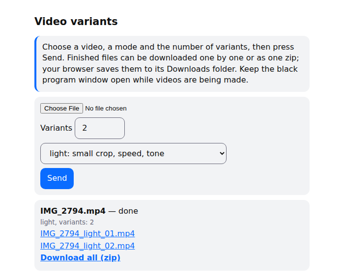

# reeluniq: variants of your own videos

Makes several different files from one video you own, for posting on more than one account. Four modes, a command line and a local web page, ffmpeg bundled in the release builds. Runs on Windows, macOS and Linux.

---

## Как пользоваться (по-русски)

1. Скачайте архив для своей системы на странице Releases: `reeluniq-windows-x64.zip` для Windows 10 и 11, `reeluniq-macos-apple-silicon.tar.gz` для Mac с чипом Apple M…, `reeluniq-macos-intel.tar.gz` для Mac с Intel (посмотреть: меню Apple, «Об этом Mac», строка «Чип»).
2. Распакуйте архив целиком. В Windows: правый клик, «Извлечь всё», из окна архива не запускать.
3. Запустите программу.
   - Windows: дважды щёлкните `reeluniq.exe`. Если появилось «Система Windows защитила ваш компьютер»: «Подробнее», затем «Выполнить в любом случае». Программа не подписана, поэтому так бывает при первом запуске.
   - Mac: один раз откройте Терминал в распакованной папке и выполните `xattr -dr com.apple.quarantine .`, затем `./reeluniq`.
4. Откроется чёрное окно и страница в браузере (если нет, откройте `http://127.0.0.1:8765`). Чёрное окно закрывать нельзя, пока идёт обработка: это и есть программа.
5. На странице выберите видео, режим и число версий, нажмите «Отправить». Когда будет готово, скачайте файлы по одному или кнопкой «Скачать всё одним архивом (zip)». Браузер положит их в «Загрузки».
6. Чтобы выйти, закройте чёрное окно.

| Режим | Что делает | Скорость |
|---|---|---|
| метаданные (`meta`) | меняет служебные данные файла, картинка и звук те же | быстро |
| лёгкий (`light`) | небольшая обрезка, чуть другая скорость, высота звука и тон | быстро |
| пыль (`dust`) | то же и мелкие правки пикселей | быстро |
| оператор (`operator`) | медленное плавное движение кадра | дольше всех |

Исходное видео остаётся на месте. Копию, которую страница загрузила в программу, программа удаляет после обработки. В каждом архиве лежит `ЧИТАЙ-МЕНЯ.txt` с теми же шагами.

Из командной строки:

    reeluniq make клип.mp4 -m light -n 3     # три версии в папке клип_variants/
    reeluniq watch ~/Видео/входящие -m dust  # файлы, брошенные в папку, получают версии сами

---

## What this is

For a video you shot or hold a licence for, `reeluniq` writes N variants whose bytes, frames and timing differ a little, so the same clip can go to more than one account.

| Mode | What changes |
|---|---|
| `meta` | Metadata and container structure. Picture and sound are copied bit for bit. |
| `light` | 4 to 6 % crop, speed ×1.005 to ×1.015, frame rate ±1, pitch ±1 %, tone within ±2 %. |
| `dust` | `light`, plus noise, ±1 px frame jitter, up to 0.3° rotation, 1 px chroma shift. |
| `operator` | Slow zoom drift between 5 and 11 %, up to 10 px of pan, eased to a stop at every turn. |

It is a small personal utility for one person on their own machine: no accounts, no server to run, no outgoing connections. What a platform treats as a duplicate is the platform's decision, and no mode guarantees reach. Against a neural similarity model the variants stay close to the original (see [Measured](#measured)).

## Install

Download from Releases, unpack, start `reeluniq`. ffmpeg is included, and each archive holds `ЧИТАЙ-МЕНЯ.txt`, a short guide in Russian with the same steps.

| System | File | First start |
|---|---|---|
| Windows 10, 11 (64-bit) | `reeluniq-windows-x64.zip` | double-click `reeluniq.exe`; if SmartScreen stops it: *More info*, then *Run anyway* |
| Mac, Apple silicon (M1 and later) | `reeluniq-macos-apple-silicon.tar.gz` | see below |
| Mac, Intel | `reeluniq-macos-intel.tar.gz` | see below |

The builds are not signed, so macOS blocks the first start. Once, from the unpacked folder in Terminal:

    xattr -dr com.apple.quarantine .
    ./reeluniq

To see which Mac you have, open Apple menu, About This Mac; the Chip line reads Apple M… or Intel.

From source (Linux, or anywhere with Python 3.10+): `pip install .`. It needs `ffmpeg` and `ffprobe` on the `PATH` or in `REELUNIQ_FFMPEG` and `REELUNIQ_FFPROBE`; HDR sources also need a build with the `zscale` filter.

What it touches

It starts `ffmpeg` and `ffprobe` as child processes and writes the variants and `report.json` next to the source (or to `--out`; `watch` writes to `<folder>/variants/<file name>/`). `app` opens a page on `127.0.0.1:8765` and keeps uploads and results under `%LOCALAPPDATA%\reeluniq\web` (Windows), `~/Library/Application Support/reeluniq/web` (macOS) or `~/.local/share/reeluniq/web` (Linux). An uploaded original is deleted when its variants are done, and result folders older than two days are removed on the next upload or start. Nothing is installed to start with the system. To remove it, delete the unpacked folder (or `pip uninstall reeluniq`) and the data folder above.

**What leaves your machine.** Nothing: the program makes no network connections. With `--host 0.0.0.0` the page is reachable from your local network; it then asks for a PIN, one attempt at a time, over plain http, so use it only on a network you trust.

## Walkthrough

    $ reeluniq make IMG_2794.MP4 -m operator -n 2
    IMG_2794.MP4 -> IMG_2794_variants  (mode=operator, n=2, seed=1)
      [1/2] IMG_2794_operator_01.mp4  zoom 1.061-1.076, pan up to 5.8 px, zoom rate up to 0.004/s
      [2/2] IMG_2794_operator_02.mp4  zoom 1.059-1.082, pan up to 5.8 px, zoom rate up to 0.0065/s
    done: 2 file(s); report: IMG_2794_variants/report.json

The other commands:

    reeluniq app                          # a page opens in the browser: pick a video and a mode, download the variants
    reeluniq make clip.mp4 -m light -n 3  # variants in clip_variants/
    reeluniq watch ~/Videos/inbox -m dust # files dropped in the folder get variants in inbox/variants/<file name>/

Without `-m` the mode is `light`; without `-n`, three variants. The same `--seed` draws the same parameters (in `meta` the timestamps follow the clock).

The page after a run of `light` with two variants:

Double-clicking the program opens this page and a console window. Closing the window quits the program.

## Measured

One variant per mode of a real clip: 3840×2160 HEVC at 29.97 fps, 14 s, 75 MB. ffmpeg 8.1.2, limited to 2 cores at low priority on a desktop CPU. Variants are 1920×1080 H.264 at CRF 18 with AAC audio; `meta` copies the original streams.

| Mode | Time | Size | SSCD, median | Frames at 0.75 or above |
|---|---|---|---|---|
| `meta` | 29 s | 75 MB | 1.000 | 100 % |
| `light` | 28 s | 19 MB | 0.926 | 100 % |
| `dust` | 43 s | 22 MB | 0.924 | 100 % |
| `operator` | 49 s | 19 MB | 0.946 | 100 % |

`meta` takes as long as `light` because it decodes both files afterwards to check that picture and sound are unchanged (the report says so for every file).

SSCD (`sscd_disc_mixup`, the open copy-detection model) compares frames sampled at 2 per second; each variant frame is matched to its nearest original frame. 0.75 is the point the model's authors give for about 90 % precision, so a frame at or above it counts as the same picture. All four modes stay above it: the files and their hashes differ, the frames still read as the original to this model. One clip and one open model; the closed models platforms use were not measured.

## Testing

    pip install -e '.[test]'
    pytest -m unit           # no external programs
    pytest -m integration    # needs ffmpeg and ffprobe

22 tests in two groups: unit (the operator path, the page and its PIN mode, the job queue, the command line) and integration (every mode on a synthetic clip, `meta` output, the hot folder, the HDR round trip). CI runs both on Linux, Windows and macOS.

## Design decisions and known limitations

- [`KEY_DECISIONS.md`](KEY_DECISIONS.md): why ffmpeg runs as a separate program, why `operator` warps every frame itself, why the unsigned builds, and the rest
- [`docs/known-issues.md`](docs/known-issues.md): what is not tested and what is known to be limited

## License

[Apache-2.0](LICENSE). The release builds bundle unmodified GPL builds of FFmpeg; sources and licences are listed in `THIRD-PARTY.txt` inside each archive.
