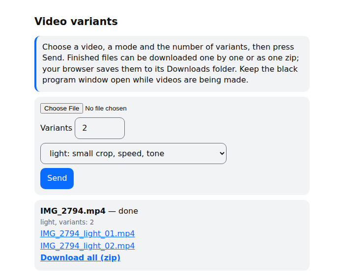

# reeluniq: варианты ваших собственных видео

[English](README.md) | Русский

Делает из одного вашего видео несколько разных файлов, чтобы публиковать их с нескольких аккаунтов. Четыре режима, командная строка и локальная веб-страница, в готовые сборки встроен ffmpeg. Работает в Windows, macOS и Linux.

---

## Как пользоваться

1. Скачайте архив для своей системы на странице Releases: `reeluniq-windows-x64.zip` для Windows 10 и 11, `reeluniq-macos-apple-silicon.tar.gz` для Mac с чипом Apple M…, `reeluniq-macos-intel.tar.gz` для Mac с Intel (посмотреть: меню Apple, «Об этом Mac», строка «Чип»).
2. Распакуйте архив целиком. В Windows: правый клик, «Извлечь всё», из окна архива не запускать.
3. Запустите программу.
   - Windows: дважды щёлкните `reeluniq.exe`. Если появилось «Система Windows защитила ваш компьютер»: «Подробнее», затем «Выполнить в любом случае». Программа не подписана, поэтому так бывает при первом запуске.
   - Mac: один раз откройте Терминал в распакованной папке и выполните `xattr -dr com.apple.quarantine .`, затем `./reeluniq`.
4. Откроется чёрное окно и страница в браузере (если нет, откройте `http://127.0.0.1:8765`). Чёрное окно закрывать нельзя, пока идёт обработка: это и есть программа.
5. На странице выберите видео, режим и число версий, нажмите «Отправить». Когда будет готово, скачайте файлы по одному или кнопкой «Скачать всё одним архивом (zip)». Браузер положит их в «Загрузки».
6. Чтобы выйти, закройте чёрное окно.
7. Язык и другие настройки: файл `reeluniq.env` рядом с программой, например строка `REELUNIQ_LANG=ru` (уберите `#` в начале и перезапустите).

Из командной строки:

    reeluniq make клип.mp4 -m light -n 3     # три версии в папке клип_variants/
    reeluniq watch ~/Видео/входящие -m dust  # файлы, брошенные в папку, получают версии сами

Исходное видео остаётся на месте. Копию, которую страница загрузила в программу, программа удаляет после обработки. В каждом архиве лежит `ЧИТАЙ-МЕНЯ.txt` с теми же шагами.

## Что это

Для видео, которое вы сняли сами или на которое у вас есть лицензия, `reeluniq` делает N вариантов. Байты, кадры и тайминг у них немного отличаются, поэтому один ролик можно выложить с нескольких аккаунтов.

| Режим | Что меняется |
|---|---|
| `meta` | Служебные данные и структура контейнера. Картинка и звук не перекодируются (отчёт проверяет, что кадры и отсчёты звука декодируются одинаково); переписываются контейнер и, у x264-источников, блоки SEI. |
| `light` | Обрезка от 4 до 6 %, скорость от ×1,005 до ×1,015, частота кадров ±1, высота звука ±1 %, тон в пределах ±2 %. |
| `dust` | `light`, плюс шум, дрожание кадра ±1 px, поворот до 0,3°, сдвиг цветности на 1 px, лёгкое повышение резкости. |
| `operator` | Медленное плавное приближение и отдаление в пределах от 5 до 11 %, сдвиг до 10 px, с плавной остановкой в каждой точке разворота. |

`light`, `dust` и `operator` перекодируют видео в H.264 и не отдают больше 1080p по короткой стороне: источник в 4K выйдет в Full HD. HDR-источники (PQ или HLG) переводятся в SDR. `meta` размер и HDR не меняет. Для `meta` нужен файл MP4 или MOV; остальные режимы берут любой файл, который читает ffmpeg (страница и `watch` подхватывают `.mp4`, `.mov` и `.m4v`).

Это небольшая личная утилита для одного человека на его компьютере: ни аккаунтов, ни сервера, ни исходящих соединений. Что считать дублем, решает площадка, и ни один режим не гарантирует охват. Для нейросетевой модели сходства варианты остаются близкими к оригиналу (см. [Измерения](#измерения)).

## Установка

Скачайте архив на странице Releases, распакуйте, запустите `reeluniq`. ffmpeg внутри, в каждом архиве лежит `ЧИТАЙ-МЕНЯ.txt` с теми же шагами.

| Система | Файл | Первый запуск |
|---|---|---|
| Windows 10, 11 (64 бита) | `reeluniq-windows-x64.zip` | дважды щёлкнуть `reeluniq.exe`; если SmartScreen остановил: «Подробнее», затем «Выполнить в любом случае» |
| Mac, Apple silicon (M1 и новее) | `reeluniq-macos-apple-silicon.tar.gz` | см. ниже |
| Mac, Intel | `reeluniq-macos-intel.tar.gz` | см. ниже |

Сборки не подписаны, поэтому macOS блокирует первый запуск. Один раз, из распакованной папки в Терминале:

    xattr -dr com.apple.quarantine .
    ./reeluniq

Какой у вас Mac: меню Apple, «Об этом Mac», строка «Чип» начинается с Apple M… или с Intel.

Из исходников (Linux или любая система с Python 3.10+): `pip install .`. Нужны `ffmpeg` и `ffprobe` в `PATH` или в `REELUNIQ_FFMPEG` и `REELUNIQ_FFPROBE`; для HDR-источников нужна сборка с фильтром `zscale`.

Что программа трогает

Она запускает `ffmpeg` и `ffprobe` как дочерние процессы и пишет варианты и `report.json` рядом с исходником (или в `--out`; `watch` пишет в `<папка>/variants/<имя файла>/`). `app` открывает страницу на `127.0.0.1:8765` и хранит загрузки и результаты в `%LOCALAPPDATA%\reeluniq\web` (Windows), `~/Library/Application Support/reeluniq/web` (macOS) или `~/.local/share/reeluniq/web` (Linux). Загруженный оригинал удаляется, когда варианты готовы, а папки результатов старше двух суток удаляются при следующей загрузке или запуске. Видео может весить до 4 ГБ, в очереди одновременно ждут не больше 8 видео, а страница делает до 8 вариантов одного видео. В автозагрузку ничего не добавляется. Чтобы удалить программу, удалите распакованную папку (или выполните `pip uninstall reeluniq`) и папку с данными выше.

## Настройки

Значения по умолчанию (язык, режим, число вариантов, папка результатов, адрес и порт страницы, PIN, открытие браузера) задаются в текстовом файле `reeluniq.env` и в переменных `REELUNIQ_*`. Флаг сильнее переменной, переменная сильнее файла, файл сильнее встроенного значения.

| Имя | Значения | По умолчанию |
|---|---|---|
| `REELUNIQ_LANG` | `auto` (как в системе), `ru`, `en`; страница, консоль и `--help` | `auto` |
| `REELUNIQ_MODE` | `light`, `dust`, `operator`, `meta` | `light` |
| `REELUNIQ_COUNT` | 1 или больше (страница предлагает до 8 и ограничивает этим числом) | `3` |
| `REELUNIQ_OUT` | папка для результатов `make` (внутри неё `<имя>_variants/`) и `watch`; у страницы своя папка | рядом с исходником |
| `REELUNIQ_HOST`, `REELUNIQ_PORT`, `REELUNIQ_PIN` | как `--host`, `--port`, `--pin` у `app` | `127.0.0.1`, `8765`, случайный |
| `REELUNIQ_BROWSER` | `yes` или `no`: открывать ли страницу при запуске | `yes` |

В архивах `reeluniq.env` лежит рядом с программой, все строки закомментированы: уберите `#` у нужной строки и перезапустите. При установке из исходников файл ищется в `~/.local/share/reeluniq/` (Linux), `~/Library/Application Support/reeluniq/` (macOS) или `%LOCALAPPDATA%\reeluniq\` (Windows); другой файл можно указать в `REELUNIQ_CONFIG`. Неверное значение останавливает программу с сообщением, где названа настройка; неизвестная строка даёт сообщение с именем файла и номером строки; `REELUNIQ_CONFIG`, указывающий на несуществующий файл, считается ошибкой. `REELUNIQ_FFMPEG` и `REELUNIQ_FFPROBE` остаются только переменными.

С вашего компьютера ничего не уходит: программа не делает сетевых соединений. С `--host 0.0.0.0` страница доступна из вашей локальной сети; тогда она запрашивает PIN, по одной попытке за раз, по обычному http, так что включайте это только в сети, которой доверяете.

## Пример

    $ reeluniq make IMG_2794.MP4 -m operator -n 2 --seed 1
    IMG_2794.MP4 -> IMG_2794_variants  (mode=operator, n=2, seed=1)
      [1/2] IMG_2794_operator_01.mp4  zoom 1.061-1.076, pan up to 5.8 px, zoom rate up to 0.004/s
      [2/2] IMG_2794_operator_02.mp4  zoom 1.059-1.082, pan up to 5.8 px, zoom rate up to 0.0065/s
    done: 2 file(s); report: IMG_2794_variants/report.json

Остальные команды:

    reeluniq app                          # в браузере откроется страница: выберите видео и режим, скачайте варианты
    reeluniq watch ~/Videos/inbox -m dust # файлы, брошенные в папку, получают варианты в inbox/variants/<имя файла>/

Без `-m` режим `light`, без `-n` три варианта. Без `--seed` каждый запуск берёт новое число (оно печатается и сохраняется в `report.json`), поэтому два запуска на одном ролике дают разные файлы; одинаковый `--seed` даёт одинаковые параметры (в `meta` метки времени зависят от часов).

Страница после запуска `light` с двумя вариантами:

Двойной щелчок по программе открывает эту страницу и окно консоли. Закрытие окна завершает программу.

## Измерения

Один вариант на режим для настоящего ролика: 3840×2160 HEVC, 29,97 к/с, 14 с, 75 МБ. ffmpeg 8.1.2, два ядра с низким приоритетом на настольном процессоре. Варианты 1920×1080 H.264 с CRF 18 и звуком AAC; `meta` копирует исходные потоки.

| Режим | Время | Размер | SSCD, медиана | Кадры с 0,75 и выше |
|---|---|---|---|---|
| `meta` | 29 с | 75 МБ | 1,000 | 100 % |
| `light` | 28 с | 19 МБ | 0,926 | 100 % |
| `dust` | 43 с | 22 МБ | 0,924 | 100 % |
| `operator` | 49 с | 19 МБ | 0,946 | 100 % |

`meta` идёт столько же, сколько `light`, потому что после работы декодирует оба файла и проверяет, что картинка и звук не изменились (отчёт пишет это для каждого файла).

SSCD (`sscd_disc_mixup`, открытая модель поиска копий) сравнивает кадры, взятые 2 раза в секунду; каждый кадр варианта сопоставляется с ближайшим кадром оригинала. 0,75 это порог, при котором, по данным авторов модели, точность около 90 %, поэтому кадр с этим значением и выше считается той же картинкой. Все четыре режима остаются выше порога: файлы и их хеши различаются, а кадры для этой модели всё ещё выглядят как оригинал. Один ролик и одна открытая модель; закрытые модели площадок не измерялись.

## Тесты

    pip install -e '.[test]'
    pytest -m unit           # без внешних программ
    pytest -m integration    # нужны ffmpeg и ffprobe

67 тестов в двух группах: unit (путь `operator`, страница, её режим с PIN и её ограничения, очередь задач, командная строка, настройки, запускатель) и integration (каждый режим на синтетическом ролике, результат `meta`, горячая папка, круг HDR). CI запускает обе группы на Linux, Windows и macOS.

## Решения и известные ограничения

Оба документа на английском.

- [`KEY_DECISIONS.md`](KEY_DECISIONS.md): почему ffmpeg запускается отдельной программой, почему `operator` сам искажает каждый кадр, почему сборки не подписаны, и остальное
- [`docs/known-issues.md`](docs/known-issues.md): что не проверено и что известно как ограничение

## Лицензия

[Apache-2.0](LICENSE). В готовые сборки входят немодифицированные GPL-сборки FFmpeg; исходники и лицензии перечислены в `THIRD-PARTY.txt` внутри каждого архива.
